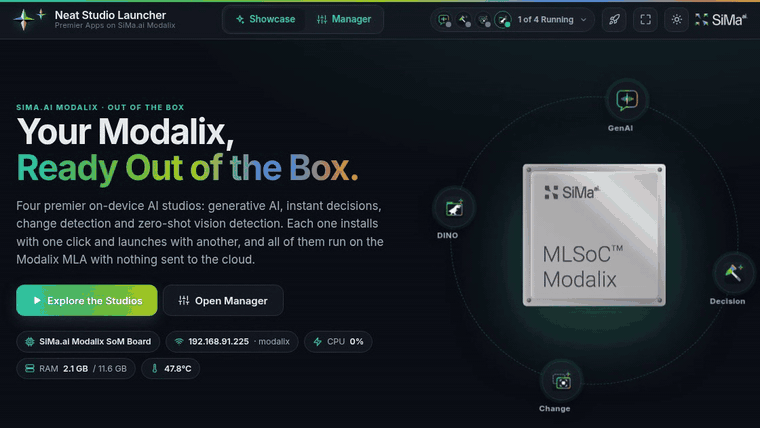
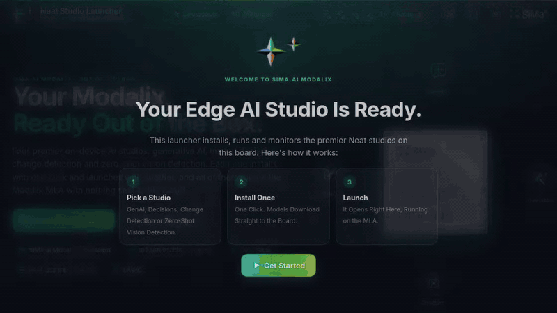
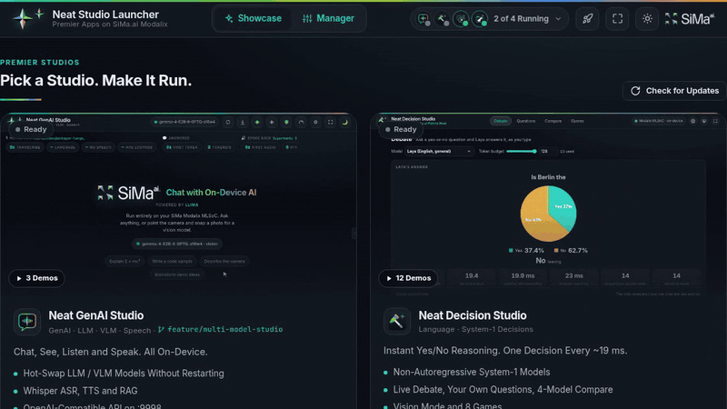
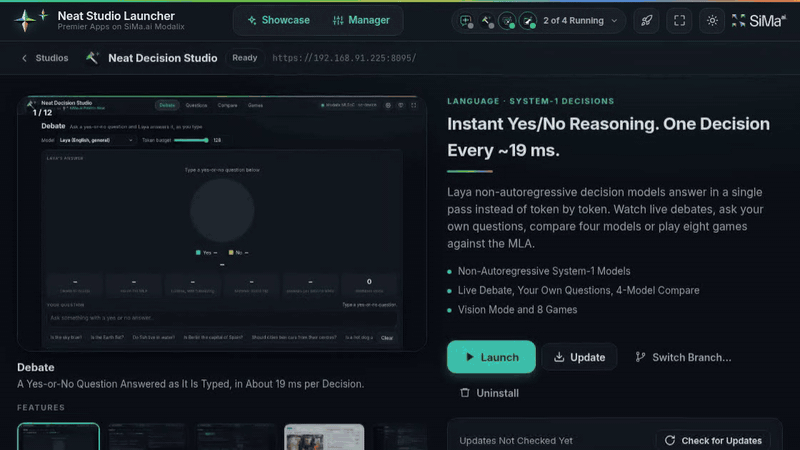
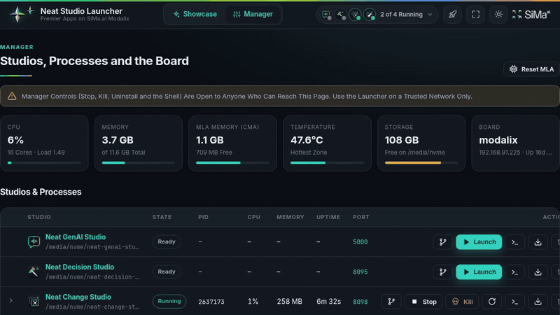

# Neat Studio Launcher

<p align="center"></p>
<p align="center"><em>The out-of-box home for the premier Neat studios on SiMa.ai Modalix: one click to install, one click to launch.</em></p>

## Metadata

| Field | Value |
|---|---|
| Category | Launcher · Showcase · Device manager |
| Difficulty | Beginner |
| Tags | SiMa.ai, Modalix, Neat, MLA, Out of the box |
| Languages | Python, JavaScript |
| Status | Preview |
| Binary Name | `neat-studio` |
| Studios | [GenAI](https://github.com/dotimothy/neat-genai-studio) · [Decision](https://github.com/dotimothy/neat-decision-studio) · [Change](https://github.com/dotimothy/neat-change-studio) · [DINO, zero-shot vision detection](https://github.com/dotimothy/neat-dino-studio) |

## Preview

<table>
<tr>
<td width="50%"><br><b>Launch Animation.</b> A SiMa.ai Modalix chip warps in through a starfield, bursts into the Neat palette and reveals the four studios. A first visit waits for <b>Explore the Studios</b>.</td>
<td width="50%"><br><b>One-Click Launch.</b> Neat Decision Studio starts next to the studios already on the MLA. Its boot log streams live, then it opens inside the launcher with a log drawer.</td>
</tr>
<tr>
<td><br><b>Demo Galleries.</b> Every studio's README GIFs are built in: arrow keys, Features and Games groups, and a full-screen viewer.</td>
<td><br><b>Manager.</b> Studio status, processes, update checks by commit hash, a shell on the board, live logs, and installing from another branch.</td>
</tr>
</table>

## Concept

Opening the launcher plays a short launch animation: a SiMa.ai Modalix chip flies in from deep space, bursts into the Neat colour palette, and the launcher appears. It plays once per browser session. Skip, Esc or a double-click ends it, and it never plays on its own with reduced motion. Replay it with the rocket button in the header, the **Replay Launch Animation** link in the footer, or `?intro` in the URL. `?nointro` turns it off.

Every studio's demo GIFs from its README are built in (25 in all, in `src/launcher/static/studios/<id>/gallery/`):
- each card shows the studio's main GIF and how many demos it has
- each studio page has a captioned gallery (Features and Games, ← / → keys, full screen)
- the home page has a **See Them in Action** reel of all of them

A GIF only plays while it is on screen, and shows its first frame otherwise.

The header shows every studio's status at a glance: one icon and dot per studio, and a dropdown with each one's state and next action. Any studio can be uninstalled from its card's **⋯** menu, its studio page, or the Manager.

One web portal on the board that:

- **Showcases** each studio and what it proves about Modalix (on-device, real-time on the MLA, private).
- **Installs** any studio with one click: it downloads the source, runs the studio's own `setup.sh` non-interactively and streams the output live. Install uses each repo's default branch (`main`). **Install From Branch…** (on the studio page, in a card's **⋯** menu, or in the Manager) lists the repo's branches and installs any of them. For an installed studio it becomes **Switch Branch…**: a downloaded copy gets that branch's files over the installed ones (models and settings stay), and a git checkout does a `git checkout` that stops if there are uncommitted edits. The branch is remembered, and update checks and Update follow it.
- **Launches** a studio with one click and opens it inside the launcher (or pops it out to its own tab). The MLA runs best with one studio at a time, so launching one offers to stop the others first, or to run alongside them.
- **Checks for updates** by commit hash, against each studio's GitHub repository (and the launcher's own), and updates with one click:
  - a **git checkout** compares its HEAD with the same branch on GitHub and says how many commits it is behind or ahead
  - a **downloaded copy** has every file hashed the way git does and compared with the files in the branch's latest commit: identical means up to date; otherwise it finds which recent commit is installed ("N Commits Behind") or says "Differs From Latest in N Files" and lists them
  - everything goes over plain git, not GitHub's REST API, so there is no hourly request limit: branch lists come from `git ls-remote`, and downloaded copies are compared against a small mirror of each repo in `.cache/mirrors` (commit history and file lists only, a few hundred KB). If GitHub can't be reached, the last result stays on screen, marked as last known.
- **Manages** everything: per-studio processes with PID, CPU, memory and uptime, Stop (graceful, then SIGKILL after 10 s), Kill, Kill a single PID, Restart, Uninstall and Reset MLA. It also shows live logs for every studio and a full interactive shell in the browser.

Studios that were already installed (for example `/media/nvme/laya` for Decision) or started some other way (desktop icon, alias) are found and managed too.

> **Security:** the Manager page (stop, kill, uninstall, shell) has no login. Anyone who can reach the launcher can use it, so run it on a trusted network only.

## Install

On the Modalix DevKit:

```bash
cd /media/nvme
curl -fsSL https://raw.githubusercontent.com/dotimothy/neat-studio-launcher/main/install.sh | bash
```

This fetches the launcher and runs `./setup.sh`, which:

- creates `.venv` with Flask, Flask-SocketIO, psutil and PyYAML
- creates a self-signed certificate
- adds the **`neat-studio`** alias
- puts a **Neat Studio Launcher** icon on the desktop

## Run

```bash
neat-studio               # or ./run.sh   (Ctrl+C stops it)
neat-studio --daemon      # in the background
neat-studio --open-browser
```

Then open `https://<board-ip>:8090/` and accept the self-signed certificate once. You can also double-click the desktop icon, which starts the launcher in the background and opens the browser.

| Command | What it does |
|---|---|
| `neat-studio stop` | Stop the launcher. Studios keep running. |
| `neat-studio status` | Show whether the launcher is running, and its URL |
| `neat-studio update` | Update the launcher from GitHub |
| `neat-studio logs` | Follow the background launcher's log |
| `--port N`, `--host H`, `--no-https` | Change where it listens |

### Studios in the launcher

Every studio uses its own self-signed certificate. The first time a studio opens inside the launcher, the browser may ask you to trust it: click **Open … to trust it**, choose *Advanced → Proceed*, then **Retry**.

## Configure

Studios are described in `src/launcher/studios.yaml`: repository, install folder, setup / launch / update commands, port, health endpoint, process patterns and marketing copy. To override any field without editing that file, create `config.local.yaml` next to `run.sh`:

```yaml
install_root: /media/nvme
studios:
  - id: change
    setup: CYWS_MODELS=all ./setup.sh --no-prompt --no-desktop-icon
```

Environment variables: `LAUNCHER_PORT` (8090), `LAUNCHER_HOST`, `LAUNCHER_HTTPS=0`, `NEAT_STUDIOS_ROOT`, `NEAT_LAUNCHER_STOP_GRACE` (10 s), `NEAT_LAUNCHER_CACHE` (where the update-check mirrors live; default `.cache`).

## Verify

```bash
curl -k https://localhost:8090/health
curl -k https://localhost:8090/api/studios
curl -k -X POST https://localhost:8090/api/studios/dino/launch -H 'Content-Type: application/json' -d '{"mode":"exclusive"}'
curl -k -X POST https://localhost:8090/api/studios/dino/stop
curl -k https://localhost:8090/api/updates
```

## Source Files

- Web app and API: `src/launcher/app.py`, entry point `src/launcher/main.py`
- Install / launch / stop / logs: `src/launcher/procman.py`
- Studio registry: `src/launcher/registry.py`, `src/launcher/studios.yaml`
- Update checks: `src/launcher/updates.py`
- Browser shell (PTY): `src/launcher/terminal.py`
- Board stats: `src/launcher/sysinfo.py`
- UI: `src/launcher/templates/index.html`, `src/launcher/static/launcher.{css,js}` (design tokens shared with Neat GenAI Studio)
- Scripts: `install.sh`, `setup.sh`, `run.sh`, `src/common/desktop-launch.sh`

## Development From Source

```bash
python3 -m venv .venv && .venv/bin/pip install -r requirements.txt pytest
.venv/bin/python -m pytest tests/python/test_unit.py

# The full UI on a PC, with fake studios instead of real ones:
mkdir -p /tmp/fake/neat-dino-studio && cp tests/python/fixtures/fake_studio.py /tmp/fake/neat-dino-studio/fake.py
NEAT_LAUNCHER_CONFIG=tests/python/fixtures/fake_studios.yaml NEAT_STUDIOS_ROOT=/tmp/fake ./run.sh
```
